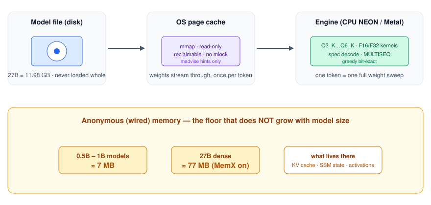

# Stratum

[English](README.md) | [简体中文](README_CN.md)


**A 27B model runs in ~77 MB of anonymous memory.** Weights stay a file: the engine `mmap`s the GGUF and reads it through the page cache. Anonymous memory stays ~7 MB from 0.5B to 1B, and ~77 MB at 27B once KV and SSM state are counted. RAM decides how much of the file stays hot, and therefore how fast the next token is. It does not decide whether the model finishes.

<p align="center"></p>

Measured on an M4 Pro, 24 GB, greedy, CPU unless noted.

| | |
|---|---|
| 27B (Qwen3.8, 11.98 GB) | **5.73 tok/s** hot short run, ~1.4–2 tok/s sustained, **~77 MB** anonymous |
| 0.5B–1B Q4_K | **68–125 tok/s**, **~7 MB** anonymous |
| vs llama.cpp, TinyLlama 1.1B | **7.4 MB vs 634.9 MB** anonymous (**85.7×**) |
| vs llama.cpp Metal, Qwen3-0.6B Q4_K_M | **247–252 tok/s** vs 224–231 (fused GPU, stop at end of turn, `STRATUM_MAX_KV=8192`) |
| Engine | ~752 KB binary. Apple Silicon. GPU optional |
| Architectures | Llama / Qwen2 / Qwen3 dense · Qwen3.5/3.8 hybrid (`qwen35`) · MoE (`llama-moe`, experimental) · DiT and H3 video spikes (separate programs) |

## Quick start

Apple Silicon. Intel Macs are out of scope. The hot path is hand-written NEON.

```sh
cd stratum/native
make                         # ./stratum  (+ Metal).  make USE_MEMX=0  or  USE_METAL=0 to leave those out
make tests

./stratum <model.gguf> 8 1 2 3          # N tokens, then prompt token ids
STRATUM_NO_GPU=1 ./stratum <model.gguf> 64 0 1
```

No weights ship with the repo. A deterministic tiny GGUF is enough to see a real greedy decode:

```sh
python3 ../tools/make_tiny_model.py --arch llama --weights q4k --out /tmp/tinyq.gguf
STRATUM_NO_GPU=1 ./stratum /tmp/tinyq.gguf 8 1 2 3 4 5 6 7 8
```

`general.architecture` selects the handler. One process, one model. The stderr line that matters is anonymous / wired memory, next to tok/s.

## How it works

One token is one pass over the weight stream. The file is mapped read-only. Pages the OS keeps are free speed; pages it drops are read again from the SSD. Anonymous memory is activations, the KV cache, and SSM state.

Three schedulers sit on that stream. A hot layer is pure compute. A cold layer is prefetched in a 50–100 MB window while the current layer runs. `STRATUM_MULTISEQ=N` runs N decode streams through one weight scan (measured **130 tok/s** aggregate at 64 streams on the 27B).

On top of that, still without requantizing or locking pages:

- **Q2_K nibble layout** (type 42) repacks the same 2-bit values. Unpack measured 2.2×. Opt-in via `STRATUM_Q2K_NIB`.
- **MoE** touches k of E experts. `moe_expert_pack.py` lays gate, up, and down of one expert in one byte range. The engine can prefetch a guess during attention and keep a decayed hot set inside a page-cache budget. The real router still chooses.
- **MTP** verifies a draft tree in one forward and rolls a miss back, so the emitted tokens match greedy. A low-confidence draft can be skipped before it pays for a weight read.
- **Metal** is per-tensor and bounded. A whole-model GPU registration is the failure mode.

The rules that keep those claims true — no requantize, no `mlock`, no whole-model NoCopy — are in [AGENTS.md](AGENTS.md).

## Read more

| | |
|---|---|
| [How it works](docs/HOW_IT_WORKS.md) | the stream, MoE pack, MTP, Metal, and the measurement tables |
| [Validation](stratum/docs/VALIDATION.md) | what the v199–v217 gates cover, and the MoE oracle |
| [Environment variables](stratum/docs/ENVVARS.md) | every `STRATUM_*` switch |
| [AGENTS.md](AGENTS.md) | boundaries and the determinism contract |
| [Head-to-head clips](media/h2h-video/) | stratum vs llama.cpp, with the raw JSON |

## License

Apache-2.0.
