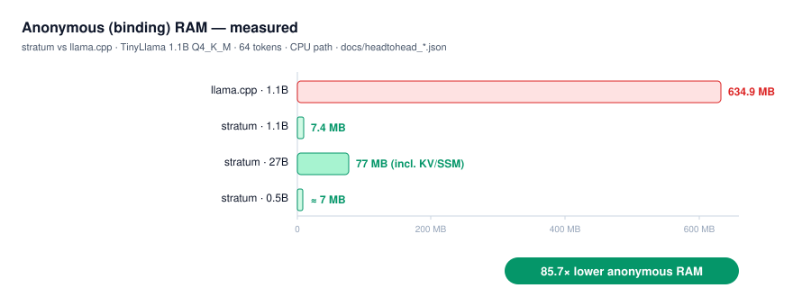
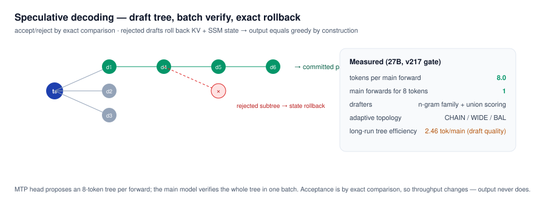

# Stratum 怎么工作

[回到 README](../README_CN.md) · [English](HOW_IT_WORKS.md)

一个 token 把权重文件读一遍。每个 token 的时间是

```
t = W × (f_hot / BW_hot + f_cold / BW_cold)
```

`W` 是文件大小。`f_hot` 是页缓存还留着的那一部分。内存改变的是 `f_hot`，不是算式。

## 权重流

GGUF 只读映射。匿名内存是激活、KV cache 和 SSM 状态：0.5B–1B 大约 7 MB，27B 大约 77 MB。权重页就是普通文件缓存。内存紧的时候操作系统丢掉它们，下一个 token 再从盘上读。

调度器按层问 `mincore`。热层只做计算。冷层在当前层计算时，对 50–100 MB 的窗口发 `madvise` / `F_RDADVISE`。`STRATUM_HOT_FAST=1` 走这条热路径，不锁页缓存。

`STRATUM_MULTISEQ=N` 让 N 条序列共享一次文件扫描。27B 上 64 流实测聚合 130 tok/s。

<p align="center"></p>

## 不改变数值的布局

**Q2_K nibble（type 42）。** 2-bit 权重仍是 0–3。字节重排之后，NEON 解包少做一半的活（实测 2.2×）。文件大约大 50%。用 `STRATUM_Q2K_NIB=<path>` 或内嵌 type-42 的 GGUF 打开。引擎在信任这份布局之前会核对数值。

**Q4K_W16（type 43）** 是同一件事的 AMX 多序列版本：Q4_K 的值，换成另一种排布。`STRATUM_AMX_W16_OFF=1` 走可移植的回退路径。

## MoE

注册名是 `llama-moe`、`llama_moe`、`moe`、`olmoe`。注意力与 llama 路径相同。FFN 是 router，加上堆叠的 `ffn_gate_exps` / `ffn_up_exps` / `ffn_down_exps` 上的 top-k。平局取编号较小的专家。

每个 token 碰到 E 个切片里的 k 个。三层调度都建在 `madvise` 上。它们不改选中的专家，也不锁页。

| 开关 | 默认 | 作用 |
|---|---|---|
| `STRATUM_MOE_PACK=<path>` | 关 | `stratum/tools/moe_expert_pack.py` 写出的 sidecar。一个专家的 gate、up、down 是一段连续字节，从 GGUF 原样拷来。一次 `WILLNEED` 盖住这个专家。加载时对不上就拒绝文件。 |
| `STRATUM_MOE_PACK_CHECK=1` | 抽样 | 每个专家都比对，不只抽样。 |
| `STRATUM_MOE_AHEAD=1` | 开 | attention 之前，用进入该层的残差做一次 hint router，把可能用到的页先缺进来。attention 之后的 router 仍是真正的选择。 |
| `STRATUM_MOE_ADAPT=1` | 开 | 衰减后的命中次数。对塞进预算的最热专家发 `WILLNEED`。 |
| `STRATUM_MOE_ADAPT_MB` | 256 | 预算，单位 MiB。`0` 关掉热集。 |
| `STRATUM_MOE_ADAPT_DROP=1` | 关 | 对掉出预算的专家发 `DONTNEED`。 |
| `STRATUM_PREFILL_B=N` | 批大小上限 | 一个 chunk 里，每个被选中的专家读一次。`1` 是逐 token。 |

```sh
python3 stratum/tools/moe_expert_pack.py model.gguf model.moep
STRATUM_NO_GPU=1 STRATUM_MOE_PACK=model.moep STRATUM_MOE_PACK_CHECK=1 \
  stratum/native/stratum model.gguf 8 1 2 3
```

用 `tiny_moe_oracle.py` 对。步骤在 [VALIDATION.md](../stratum/docs/VALIDATION.md)。F16 小模型与 oracle 一致。Q4_K 小模型可能在靠后的近似平局上和 oracle 不同；引擎的几种模式之间仍然必须一致。还没有 CI gate，也还没有全尺寸 MoE 实测。

## MTP 与 n-gram 草稿

草稿提议，主模型验证。未命中就回滚，所以离开引擎的 token 是贪心 token。

MoE 的 n-gram（`STRATUM_NGRAM_SPEC`）只在这个后缀的每一次命中都续同一个 token 时才延伸（`STRATUM_SPEC_CONF=1`，默认开）。有歧义就改试更短的后缀。Qwen3.5 的链上，`STRATUM_SPEC_MIN_P=<p>` 在叶子 top-1 概率低于 `p` 时不再延伸。不设这个变量，链保持原样。草稿不会长过你要求的 token 数。

27B 上测得的树效率是 2.46 tok/main。深度超过 4（`STRATUM_TREE_EXTEND_K`）更差。限制在草稿，不在树。

<p align="center"></p>

## Metal 与 MemX

Metal 可选。每次 matmul 可以把自己那块 tensor（大约 100 MB 以内）包成 NoCopy 视图，算完放开。按这个方式把 11.98 GB 的模型顺序读一遍，wired 大约多 0.04 GB。把整个文件、或超过大约 1 GB 的一块，注册成一个缓冲，才会把模型 wire 住。许多 matmul 放进同一个 command buffer，对逐个等待实测 17.3×（480 个 matmul，3.71 s 到 0.21 s）。

融合全 GPU 解码（`STRATUM_GPU=1 STRATUM_GPU_FULL=1`，再加上 `STRATUM_MAX_KV=8192`）在 Qwen3-0.6B Q4_K_M 上实测 247–252 tok/s，llama.cpp Metal 是 224–231，都在回合结束处停下。急切分配的 GPU KV 大约 1.84 GB。权重仍在文件里。

[MemX](https://github.com/shiaho777/memx) 可以放下 staging 缓冲和 KV/SSM 状态。上面 27B 的约 77 MB 是开着 MemX 测的。`make USE_MEMX=0` 不带它编译。开着 MemX 时，两次相同运行的 logits 平均 KL 大约可以差 1e-4；token 序列不动。`USE_MEMX=0` 才是逐字节可复现的构建。

## 能跑什么

| GGUF `general.architecture` | 代码 |
|---|---|
| `llama`、`qwen3` | `stratum_arch_llama.inc.c` |
| `qwen35`、`qwen35moe`、`qwen38` | `stratum_arch_qwen35.inc.c` — Gated DeltaNet 加全注意力，以及 MTP head |
| `llama-moe`、`llama_moe`、`moe`、`olmoe` | `stratum_arch_moe.inc.c` |
| mini-DiT、H3 视频 | `dit_probe`、`h3_*.c` — 独立程序，不是 `./stratum` |

加一种架构就是在旁边放一个 `stratum_arch_<name>.inc.c`。Makefile 会收进去。`stratum.c` 不增加名字判断。

## 实测

M4 Pro、14 核、24 GB、macOS、贪心、`STRATUM_NO_GPU=1`，命令是 `/usr/bin/time -p ./stratum <model.gguf> 64 0 1`。某一行另有说明时以那一行为准。

| 模型 | 格式 | 文件 | tok/s | 匿名内存 |
|---|---|---|---|---|
| Qwen2.5-Coder-0.5B | Q4_K | 398 MB | 125 | 约 7 MB |
| Qwen3-0.6B | Q4_K | 484 MB | 89 | 约 7 MB |
| MiniCPM5-1B | Q4_K | 688 MB | 68 | 约 7 MB |
| Qwen2.5-Coder-0.5B | F16 | 988 MB | 51 | 约 7 MB |
| Qwen3-0.6B | F16 | 1.5 GB | 40 | 约 7 MB |
| MiniCPM5-1B | F16 | 2.16 GB | 30 | 约 7 MB |
| Qwen3.8-27B mixed | Q2_K/Q4_K/Q6_K | 11.98 GB | 热缓存短跑 5.73；长生成约 1.4–2 | 约 77 MB |

TinyLlama 1.1B Q4_K_M，64 个 token：匿名内存 7.4 MB，llama.cpp 是 634.9 MB。物理占用 645 MB 对 1300 MB。

| 机器 | 这份 27B |
|---|---|
| M1 基础款，8 GB，冷 SSD | 约 0.2–0.3 tok/s（按约 3 GB/s 估算） |
| M4 Pro，24 GB | 热缓存短跑 **5.73 tok/s**，长生成约 1.4–2（实测） |
| M4 Max，48 GB 以上，热 | 约 8–10 tok/s（估算） |
| 128 GB 以上，热，nibble 布局 | 12+ tok/s（估算；Q2_K 解包 2.2×） |

对照录像和背后的 JSON 在 [media/h2h-video/](../media/h2h-video/)。

| 录像 | stratum | llama.cpp |
|---|---|---|
| Qwen3-0.6B Q4_K_M，CPU | 254.8 tok/s，占用 46 MB | 184.0 tok/s，占用 4915 MB |
| 同上，融合 GPU，`MAX_KV=8192` | 251.7 tok/s，占用 1843 MB | 223.9 tok/s，占用 4608 MB |
| MiniCPM5-2B Q4_K_M | 89–92 tok/s，占用 29 MB | 这份 GGUF 加载失败 |
| MiniCPM5-2B F16 | 19.0–19.9 tok/s，占用 32 MB | 这份 GGUF 加载失败 |

GPU 那一档的 1843 MB 是急切分配的 KV。权重在文件里。

## 限度

- 一个进程一个模型。`STRATUM_SERVER` 是串行的 stdin 循环。
- Dense 解码停在上面的公式上。MULTISEQ 提高的是合计 token，不是单条流的延迟。
- MoE 和 H3 没有 v199–v217 gate，也没有内存地板承诺。H3 在 768p 的激活是 GB 级。
- 仅 Apple Silicon。
